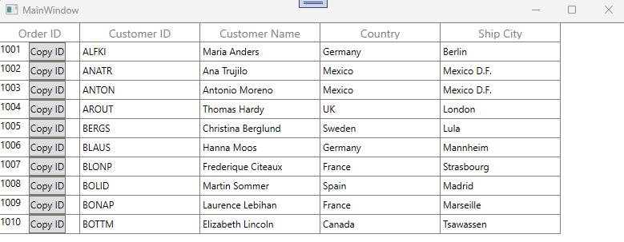

# How-to-add-columns-in-viewmodel-using-Prism-in-WPF Data Grid

In [WPF Data Grid](https://www.syncfusion.com/wpf-controls/datagrid), [columns](https://help.syncfusion.com/cr/wpf/Syncfusion.UI.Xaml.Grid.Columns.html) are typically defined in XAML or added at runtime. This example shows how to define and configure columns from the ViewModel when using Prism, keeping UI logic out of the code-behind.

## Prerequisites

- Visual Studio (2017+ recommended)
- .NET Framework or .NET Core compatible with Syncfusion WPF controls
- Syncfusion WPF controls (Data Grid)
- Prism (for BindableBase and DelegateCommand usage)
- Basic knowledge of MVVM pattern and data binding in WPF

## What this sample demonstrates

- Creating grid columns from the ViewModel (no code-behind column creation).
- Using a DataTemplate parsed at runtime for template columns that include commands bound to the ViewModel.
- Binding an ObservableCollection of data items to the Data Grid.

**C#**
```
public class ViewModel : BindableBase
{
    // Backing fields
    private ObservableCollection<OrderInfo> _orders;
    private Columns sfGridColumns;

    // Command to copy
    public DelegateCommand<OrderInfo> CopyCommand { get; }

    // Property for Orders collection
    public ObservableCollection<OrderInfo> Orders
    {
        get { return _orders; }
        set { SetProperty(ref _orders, value); }
    }

    // Property for Data Grid columns
    public Columns SfGridColumns
    {
        get { return sfGridColumns; }
        set { SetProperty(ref sfGridColumns, value); }
    }

    public ViewModel()
    {
        // Initialize the command with the method to execute
        CopyCommand = new DelegateCommand<OrderInfo>(CopyAccountNo);

        // Set up the grid columns
        SetSfGridColumns();

        // Generate sample data
        _orders = new ObservableCollection<OrderInfo>();
        this.GenerateOrders();
    }

    /// <summary>
    /// Generates sample order data.
    /// </summary>
    private void GenerateOrders()
    {
        _orders.Add(new OrderInfo(1001, "Maria Anders", "Germany", "ALFKI", "Berlin"));
        _orders.Add(new OrderInfo(1002, "Ana Trujilo", "Mexico", "ANATR", "Mexico D.F."));
        _orders.Add(new OrderInfo(1003, "Antonio Moreno", "Mexico", "ANTON", "Mexico D.F."));
        _orders.Add(new OrderInfo(1004, "Thomas Hardy", "UK", "AROUT", "London"));
        _orders.Add(new OrderInfo(1005, "Christina Berglund", "Sweden", "BERGS", "Lula"));
        _orders.Add(new OrderInfo(1006, "Hanna Moos", "Germany", "BLAUS", "Mannheim"));
        _orders.Add(new OrderInfo(1007, "Frederique Citeaux", "France", "BLONP", "Strasbourg"));
        _orders.Add(new OrderInfo(1008, "Martin Sommer", "Spain", "BOLID", "Madrid"));
        _orders.Add(new OrderInfo(1009, "Laurence Lebihan", "France", "BONAP", "Marseille"));
        _orders.Add(new OrderInfo(1010, "Elizabeth Lincoln", "Canada", "BOTTM", "Tsawassen"));
    }

    /// <summary>
    /// Sets up the columns for the Data Grid.
    /// </summary>
    private void SetSfGridColumns()
    {
        string cellTemplateXaml =
            @"<DataTemplate xmlns='http://schemas.microsoft.com/winfx/2006/xaml/presentation'
                        xmlns:x='http://schemas.microsoft.com/winfx/2006/xaml'
                        xmlns:syncfusion='http://schemas.syncfusion.com/wpf'>
            <StackPanel Orientation='Horizontal'>
                <TextBlock Text='{Binding OrderID}' Margin='0,0,10,0'/>
                <Button Content='Copy ID'
                        Command='{Binding DataContext.CopyCommand,ElementName=sfGrid}'
                        CommandParameter='{Binding}'/>
            </StackPanel>
        </DataTemplate>";

        var template = (DataTemplate)XamlReader.Parse(cellTemplateXaml);

        var cols = new Columns();

        cols.Add(new GridTemplateColumn
        {
            MappingName = "OrderID",
            HeaderText = "Order ID",
            CellTemplate = template,
            Width = 100
        });

        cols.Add(new GridTextColumn
        {
            MappingName = "CustomerID",
            HeaderText = "Customer ID"
        });

        cols.Add(new GridTextColumn
        {
            MappingName = "CustomerName",
            HeaderText = "Customer Name"
        });

        cols.Add(new GridTextColumn
        {
            MappingName = "Country",
            HeaderText = "Country"
        });

        cols.Add(new GridTextColumn
        {
            MappingName = "ShipCity",
            HeaderText = "Ship City"
        });

        sfGridColumns = cols;
    }

    /// <summary>
    /// Copies the OrderID of the given order to the clipboard.
    /// </summary>
    /// <param name="orderID"></param>
    private void CopyAccountNo(OrderInfo orderID)
    {
        if (orderID == null || orderID.OrderID == null)
            return;
        var text = orderID.OrderID.ToString();
        Clipboard.SetText(text);
    }
}
```



## How to use

1. Set the ViewModel as the DataContext of your view (e.g., via Prism view-model locator or manually).
2. Bind your Data Grid columns collection to the ViewModel property containing the Columns instance (for example, `SfGridColumns`).
3. Bind the ItemsSource of Data Grid to the `Orders` collection.
4. Ensure the element name `sfGrid` (used in the template's ElementName binding) matches the name of your Data Grid control in XAML so the template can resolve DataContext commands on the grid's DataContext.

## Notes and tips

- Because templates are parsed at runtime (XamlReader.Parse), ensure any required XML namespaces are included inside the template string.
- Keep ViewModel responsibilities focused on providing data and column metadata rather than UI logic; the template can still use commands defined in the ViewModel.
- Test bindings thoroughly—ElementName bindings require correct naming and scope to resolve.

Take a moment to peruse the [WPF Data Grid - Columns](https://help.syncfusion.com/wpf/datagrid/columns) documentation, to learn more about columns with examples.
